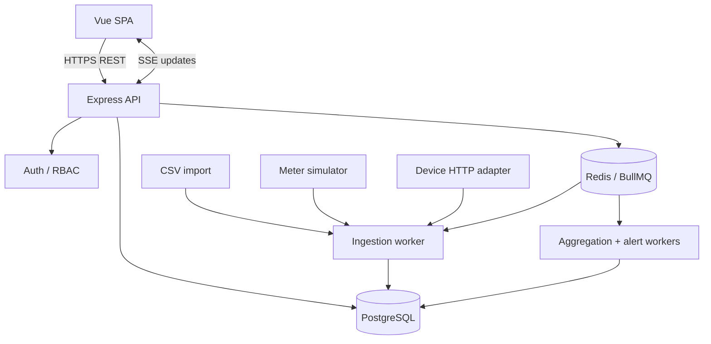
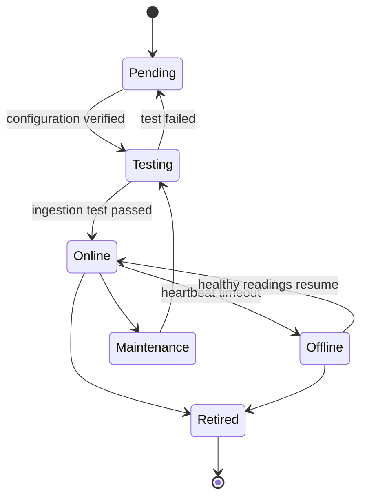
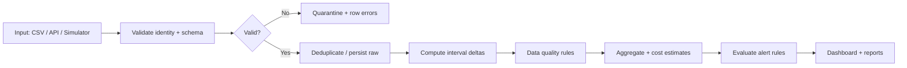
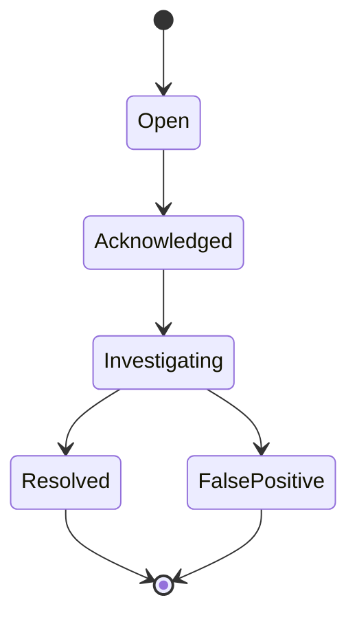
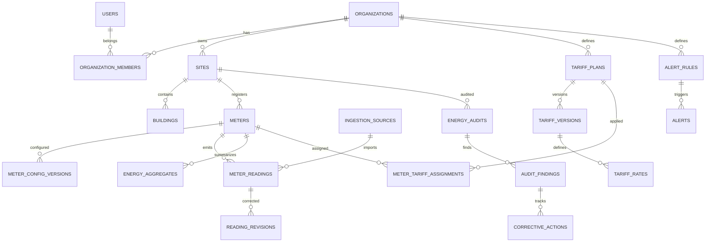

# EnergiTrack — Functional Specification Document

> **Enterprise Energy Monitoring & Sustainability Management System**  
> **Document:** FSD-ET-001 · **Version:** 1.1 · **Date:** 2026-11-17  
> **Stack:** TypeScript, Vue 3, Express.js, Prisma, PostgreSQL, Redis  
> **Status:** Development blueprint · **Language:** Bahasa Indonesia

---

## 0. Panduan penggunaan dokumen

Dokumen ini menjadi kontrak kerja antara product owner, UI/UX designer, frontend developer, backend developer, dan QA. Setiap kebutuhan memiliki ID agar dapat dipetakan ke issue, migration, route, dan test case. Angka pada gambar adalah **data ilustratif**, bukan klaim data perusahaan nyata. Visual tersedia terpisah pada `EnergiTrack-UI-Images-Full.zip` (30 PNG screen individual).

**Prioritas:** P0 = MVP wajib, P1 = release lanjutan, P2 = advanced. **Definisi selesai:** implementasi + authorization + validasi backend + test + audit event + dokumentasi API. **Out of scope MVP:** remote switching perangkat listrik, billing resmi PLN, perdagangan karbon, pelaporan pemerintah otomatis, machine-learning prediction produksi.

## 1. Executive summary dan business context

### 1.1 Gambaran produk

EnergiTrack adalah SaaS B2B multi-organisasi untuk memusatkan data penggunaan energi lintas gedung/site, menerima bacaan meter dari CSV/API/simulator, menghitung konsumsi tervalidasi, memonitor biaya dan kualitas data, menerbitkan alert, serta mengelola audit dan program efisiensi energi.

**Pengguna:** pengelola gedung, industrial facility manager, energy manager, teknisi, manajemen perusahaan, auditor. **Konteks Indonesia:** penekanan pada konservasi energi, biaya operasional, multi-site, dan kebutuhan dokumentasi energy management. Semua estimasi tarif/emisi harus memperlihatkan asumsi dan sumbernya.

### 1.2 Business problems dan target

| ID | Problem | Target sistem | Indikator pengukuran |
|---|---|---|---|
| BR-01 | Data meter terfragmentasi | Satu katalog site/meter | Persentase site yang terhubung |
| BR-02 | Konsumsi tidak dapat ditelusuri | Ledger raw readings + agregasi | Data completeness, import error rate |
| BR-03 | Lonjakan energi terlambat diketahui | Threshold alert dan notifikasi | Mean time to acknowledge |
| BR-04 | Estimasi biaya manual | Tarif versioned dan cost report | Deviasi estimasi terhadap tagihan |
| BR-05 | Perbaikan tidak terdokumentasi | Audit finding dan corrective action | Closure rate |
| BR-06 | Manajemen sulit membandingkan site | Analitik normalisasi dan periode | KPI energy intensity |

### 1.3 Stakeholders

Product owner, platform administrator, organization administrator, energy manager, facility manager, technician, energy analyst, finance viewer, auditor, developer dan QA.

### 1.4 Asumsi dan batasan

- Fase awal hanya **listrik (kWh/kW)**; data gas/air merupakan kemampuan perluasan dengan dimensi/unit berbeda.
- Meter dapat bertipe `CUMULATIVE` (register terus bertambah) atau `INTERVAL` (energi per interval). Jangan menyamakan kedua bentuk data.
- Waktu disimpan dalam UTC; setiap site memiliki IANA timezone, umumnya `Asia/Jakarta`, `Asia/Makassar`, atau `Asia/Jayapura`.
- Pemakaian biaya dan emisi adalah *estimasi berbasis konfigurasi*, bukan laporan resmi.
- Data tenant harus terisolasi. Platform support tidak memiliki akses isi tenant tanpa prosedur dukungan yang disetujui dan diaudit.

## 2. Arsitektur dan stack

| Layer | Pilihan | Fungsi |
|---|---|---|
| Frontend | Vue 3, TypeScript, Vite | SPA modular |
| Routing | Vue Router | Routes + route-level guards |
| Server state | TanStack Vue Query | Fetch, cache, retry |
| UI state | Pinia | Session, workspace, panel state |
| UI | Tailwind, shadcn-vue, ECharts | Komponen dan visualisasi data |
| Backend | Express.js + TypeScript | REST API modular monolith |
| Validation | Zod | Schema request/response |
| ORM | Prisma | Data access PostgreSQL |
| DB | PostgreSQL | Transactional + time series sederhana |
| Jobs | BullMQ + Redis | Import, aggregate, alert, report |
| Realtime | SSE | Update status/alert non-kritis |
| Auth | Secure server-side sessions | HttpOnly cookie + CSRF |
| Testing | Vitest, Supertest, Playwright | Unit, integration, E2E |
| Infra | Docker, Nginx, CI/CD | Deploy, observability |



**Engineering rules:** domain modules dipisah `routes/controllers/services/repositories/schemas`; tidak ada mutasi data langsung dari controller tanpa service; setiap job idempotent; database migration hanya lewat pipeline; tidak menaruh secrets perangkat di record plaintext.

## 3. Roles, permission, dan data scope

| Role | Scope | Permissions utama |
|---|---|---|
| Platform Admin | Platform metadata | `tenant.provision`, `platform.config` |
| Organization Admin | Satu organisasi | `org.manage`, `users.manage`, `sites.manage`, `meters.manage` |
| Energy Manager | Site yang ditugaskan | `baseline.manage`, `tariff.manage`, `audit.approve`, `report.export` |
| Facility Manager | Site yang ditugaskan | `asset.manage`, `meter.configure`, `reading.import` |
| Analyst | Site yang ditugaskan | `monitor.read`, `alert.acknowledge`, `report.generate` |
| Technician | Meter/site ditugaskan | `meter.maintain`, `alert.investigate` |
| Executive | Organisasi | `dashboard.read`, `report.read` |
| Auditor | Scope eksplisit | `audit.read`, `auditlog.read` |

Authorization dievaluasi di server dengan kombinasi permission + `organization_id` + `site_id` assignment. **404** dapat dipakai untuk resource luar tenant agar tidak membocorkan keberadaannya; **403** untuk akses yang diketahui tetapi tidak diizinkan.

## 4. Navigasi, Information Architecture, dan UI

### 4.1 IA dan URL

| Group | Menu | Route | User |
|---|---|---|---|
| Overview | Dashboard | `/dashboard` | Viewer+ |
| Operations | Sites | `/sites`, `/sites/:id` | Facility+ |
| Operations | Assets | `/assets`, `/assets/:id` | Facility+ |
| Operations | Meters | `/meters`, `/meters/new`, `/meters/:id` | Technician+ |
| Operations | Monitoring | `/monitoring`, `/monitoring/history` | Analyst+ |
| Operations | Data Imports | `/imports`, `/imports/:id` | Facility+ |
| Optimize | Tariffs & Cost | `/tariffs`, `/cost-analysis` | Energy Manager |
| Optimize | Baselines & Targets | `/baselines`, `/targets` | Energy Manager |
| Operations | Alerts | `/alerts`, `/alert-rules`, `/alerts/:id` | Analyst+ |
| Governance | Energy Audits | `/audits`, `/audits/:id` | Energy Manager |
| Governance | Emissions | `/emissions` | Analyst+ |
| Governance | Reports | `/reports`, `/reports/:id` | Analyst+ |
| Administration | Organization / Users | `/settings/organization`, `/settings/users`, `/settings/roles` | Admin |
| Administration | Integrations / Logs | `/settings/integrations`, `/settings/audit-logs` | Admin |

### 4.2 Visual direction — **precision industrial SaaS, not AI slop**

**Design language:** **dark emerald industrial SaaS**, sesuai pilihan final. Seluruh canvas, panel, form, table, dan chart area menggunakan dark surfaces; aksen emerald digunakan hemat untuk aksi primer, state aktif, dan tren energi. Dense-but-legible data grids, clear hierarchy, disciplined whitespace, no fake sci-fi HUD, no glassmorphism, no decorative gradients, no exaggerated shadows, no random emoji in navigation. Gunakan data dan status sebagai fokus utama.

| Token | Value | Usage |
|---|---|---|
| Canvas | `#071411` | Background |
| Surface | `#101F1B` | Panel, forms, tables |
| Sidebar | `#06120F` | Navigation |
| Primary | `#20D595` | Primary action, selected nav |
| Primary hover | `#15B67B` | Hover |
| Text | `#E6F5EB` | Titles |
| Muted | `#9CB5A8` | Secondary |
| Border | `#254037` | Table/panel borders |
| Danger | `#B42318` | Critical, destructive |
| Warning | `#B86B11` | Warning |
| Radius | `8px` controls, `12px` panels | Subtle rounding |
| Spacing | `4 / 8 / 12 / 16 / 24 / 32px` | 4px rhythm |
| Type | Inter or system sans | 14px body, 13px tables, 28px page title |

**Page anatomy (desktop 1440px):** 258px fixed sidebar, 36px content gutters, sticky top toolbar, breadcrumbs + title + primary action, filter toolbar, main content grid, footer pagination. Sidebar collapses on tablet; mobile uses drawer. Max content width 1600px. Charts are functional and should always have units, periods, source/quality context, and accessible tabular fallback.

**Dashboard:** 4 compact KPI cards (consumption, estimated cost, data availability, open alerts), large historical chart, status panel, recent activity table. **Meters:** search + site/status filters, table, row detail, last reading timestamp, context menu. **Forms:** label above field, examples/helper text, required indicator, inline errors, sticky save/cancel footer for long forms. **States:** skeleton loading, empty state with next action, recoverable error with retry, unsaved-changes warning, toasts for mutations, accessible confirmation for destructive actions. **Responsive:** table transforms to horizontally scrolling structured table (not arbitrarily stacking columns) at small widths.

**Asset manifest (`EnergiTrack-UI-Images-Full.zip`):** 30 screenshot `.png` individual, satu gambar UI per screen yang tercantum pada Lampiran A. Semua angka hanya data demo.

### 4.3 Common table & form standards

- Filter query persisten di URL; sort server-side; pagination default 25, choices 25/50/100; empty filter result jelas dibedakan dari empty database.
- Tombol New hanya muncul untuk role yang benar; unauthorized API tetap ditolak.
- Validasi form dua lapis (client untuk UX, server authoritative); error per field dan banner error umum; server validation `422`.
- Semua timestamps ditampilkan sesuai site timezone + timezone label; export menyertakan UTC timestamp.
- Tables memiliki bulk selection hanya jika operasi bulk terdefinisi dan aman.

## 5. Module-level FSD: screens, fields, validation, business rules

### ET-01 Authentication & Users — P0

**Screens:** Login, Forgot Password, My Profile, Users List, Invite User, Edit Membership, Roles.

| Field | Type | Required | Validation / behavior |
|---|---|---|---|
| `fullName` | text | Yes | 2–150 chars, trimmed |
| `email` | email | Yes | RFC-compatible email, unique global login |
| `password` | password | Yes (register/reset) | >=12 chars, rate-limited attempts |
| `organizationId` | UUID select | Yes | Must be authorized tenant |
| `roleId` | UUID select | Yes | Active role in tenant |
| `siteIds` | multi-select UUID | Conditional | Sites belong to same organization |
| `status` | enum | Yes | INVITED/ACTIVE/SUSPENDED |

**Actions:** invite → email token → accept → activate; edit role, revoke sessions, search/filter users. **Rules:** expired invitation unusable; suspended user sessions revoked; no privilege escalation; cannot remove final organization admin without replacement. **Acceptance:** unauthorized role update returns 403; resending invite invalidates old invite where configured.

### ET-02 Organization, Sites & Buildings — P0

**Screens:** Organization Settings, Sites List, Site Create/Edit, Site Detail, Buildings.

| Field | Type | Required | Validation |
|---|---|---|---|
| `organizationName` | text | Yes | 2–200 chars |
| `siteCode` | text | Yes | uppercase alphanumeric/hyphen, unique per org |
| `siteName` | text | Yes | 2–200 chars |
| `siteType` | enum | Yes | FACTORY/OFFICE/COMMERCIAL/WAREHOUSE/OTHER |
| `address` | textarea | Yes | 10–500 chars |
| `timezone` | select | Yes | valid IANA timezone |
| `latitude`, `longitude` | decimal | No | [-90,90], [-180,180] |
| `operatingSchedule` | structured | No | start < end, no ambiguous overlap |
| `managerId` | UUID | No | active member in same org |
| `status` | enum | Yes | ACTIVE/INACTIVE |

**Rules:** site with history archived not deleted; building must belong to selected site; site context used for chart dates; access filtered by site assignments. **Acceptance:** cannot cross-assign manager or building from another tenant.

### ET-03 Assets & Smart Meters — P0

**Screens:** Asset List, Asset Detail, Meters List, New Meter, Meter Detail, Configuration History, Maintenance.

| Field | Type | Required | Validation |
|---|---|---|---|
| `assetCode` | text | Yes for assets | unique per org |
| `meterCode` | text | Yes | unique per org |
| `serialNumber` | text | No | unique when supplied and active |
| `siteId` | UUID | Yes | authorized site |
| `assetId` | UUID | No | asset belongs to same site |
| `meterType` | enum | Yes | CUMULATIVE/INTERVAL |
| `metric` | enum | Yes | ENERGY_IMPORT/POWER_DEMAND, compatible |
| `unit` | enum | Yes | kWh/kW per metric |
| `sourceType` | enum | Yes | MANUAL/CSV/API/SIMULATOR/MQTT |
| `intervalMinutes` | integer | Yes | allowed: 1,5,15,30,60 |
| `multiplier` | decimal | Yes | >0; max set by config |
| `installedAt` | datetime | No | <= decommission date |
| `status` | enum | Yes | PENDING/TESTING/ONLINE/OFFLINE/MAINTENANCE/RETIRED |

**Rules:** configuration history effective-dated; retired meter rejects operational ingestion; unit/metric can't be swapped without migration/correction; current status cannot be self-reported as online from stale data. **Acceptance:** meter code conflict returns 409; incompatible unit returns 422.

### ET-04 Meter Reading Ingestion & Data Quality — P0

**Screens:** Import Data, Import Preview, Import History, Import Detail/Errors, Meter Readings, Data Quality.

| Field | Type | Required | Validation |
|---|---|---|---|
| `sourceId` | UUID | Yes | authorized ingestion source |
| `meterId` | UUID | Yes | active and scoped |
| `timestamp` | ISO datetime | Yes | parsed timezone + UTC normalization |
| `externalReadingId` | text | No | unique within source if present |
| `metric` | enum | Yes | matches meter configuration |
| `rawValue` | decimal string | Yes | finite; range checks by type |
| `unit` | enum | Yes | compatible with metric |
| `quality` | enum | Yes | VALID/ESTIMATED/SUSPECT/INVALID |
| `csvFile` | file | Import | CSV, <=10 MB MVP, max rows configured |
| `mode` | enum | Yes | VALIDATE_ONLY/COMMIT |

**Workflow:** upload → parse → preview errors → confirm → queued import → deduplicate → persist raw reading → compute deltas/aggregates → evaluate alerts → completion report.

**Rules:** idempotency via `(source_id, external_reading_id)` where provided or defined deterministic fingerprint; cumulative register delta computed between consecutive valid readings; rollover/reset detection; negative delta not blindly counted; out-of-order data schedules reaggregation for affected window; invalid readings quarantined; corrections stored as revisions with reason/actor, not raw overwrite. **Acceptance:** same import retried produces no duplicate effective reading; faulty CSV returns row-level errors.

### ET-05 Monitoring Dashboard — P0

**Screens:** Organization Dashboard, Monitoring Live, Monitoring Historical, Site Dashboard.

**Controls:** site/building/meter filters; energy metric; period; bucket granularity; compare previous period. **Widgets:** total kWh, peak demand kW, estimated cost IDR, completeness %, active incidents, site ranking, trend chart, latest data timestamp. **Rules:** never blend kW and kWh; missing readings are gaps not zero; chart requires min data completeness label; comparison periods same duration and timezone basis; cache per org and filter hash. **Acceptance:** filtered chart aggregates match exported data and declared interval convention.

### ET-06 Tariffs & Cost Modeling — P0

**Screens:** Tariff List, Create Version, Rate Schedule, Assign Tariff, Cost Analysis.

| Field | Type | Required | Validation |
|---|---|---|---|
| `name` | text | Yes | unique per org, <=150 |
| `currency` | enum | Yes | IDR (MVP) |
| `tariffType` | enum | Yes | FLAT/TOU |
| `unitRate` | decimal | Yes | >=0 |
| `startTime`, `endTime` | time | TOU | schedule coverage/non-overlap enforced |
| `fixedCharge` | decimal | No | >=0 |
| `taxPercent` | decimal | No | 0..100; explicitly labeled estimate |
| `effectiveFrom/To` | date | Yes/No | valid effective interval |
| `meterIds` | UUID list | Yes | same org |

**Rules:** rate version immutable after activation; non-overlapping tariff assignments per meter and time range; estimate uses rate effective at reading timestamp; no implied official PLN invoice. **Acceptance:** historical report uses historical tariff rate, not current rate.

### ET-07 Alerts & Notifications — P0

**Screens:** Alert List, Alert Detail, Rule List, Create Rule, Notification Preferences.

| Field | Type | Required | Validation |
|---|---|---|---|
| `ruleName` | text | Yes | 2–150 |
| `scopeType`, `scopeId` | enum, UUID | Yes | SITE/METER and authorized resource |
| `metric` | enum | Yes | supported metric |
| `operator` | enum | Yes | GT/LT/OUTSIDE_RANGE |
| `threshold`, `thresholdMax` | decimal | Yes/conditional | consistent range |
| `windowMinutes` | integer | Yes | >0 |
| `severity` | enum | Yes | LOW/MEDIUM/HIGH/CRITICAL |
| `cooldownMinutes` | integer | Yes | >=0 |
| `assigneeId` | UUID | No | authorized member |
| `channels` | array enum | Yes | IN_APP/EMAIL |

**Workflow:** rule breached → open alert → notify → acknowledge → investigate → resolve/false positive. **Rules:** dedupe by rule + entity + active incident; record actor/time/status changes; resolve requires disposition note; notification delivery failures retried. **Acceptance:** repeated breach within cooldown doesn't spam additional incidents.

### ET-08 Reports — P0

**Screens:** Report Builder, History, Job Detail, Download. **Fields:** report type, period UTC bounds, site/meter filter, granularity, format CSV/XLSX/PDF, timezone, generated-by. **Rules:** snapshot calculation parameters + tariff/factor versions; async jobs for large exports; time-limited signed downloads; per-tenant storage; failure reason visible. **Acceptance:** exported totals reconcile to validated aggregates within documented rounding.

### ET-09 Baselines & Targets — P1

**Screens:** Baselines List/Form, Targets List, Site Target Detail. **Fields:** site, metric, baseline start/end, normalization denominator (area or output), baseline value, target value, effective period, approval notes. **Rules:** approved baseline versioned; comparisons require consistent metric units and comparable periods; zero denominator suppresses energy-intensity KPI. **Acceptance:** changes preserve old approved baseline.

### ET-10 Energy Audits & Corrective Actions — P1

**Screens:** Audit List, New Audit, Findings, Corrective Action Board, Evidence Upload. **Fields:** site, assigned auditor, scheduled date, status, finding severity, observation, recommendation, corrective owner, due date, evidence file, approval comments. **Workflow:** Draft → Scheduled → In Progress → Submitted → Approved/Revision Required → Closed. **Rules:** approval independent from submitter if configured; closing an action requires evidence/outcome; attachments scanned. **Acceptance:** unauthorized user cannot approve own audit where separation-of-duties enabled.

### ET-11 Emission Estimates — P1

**Screens:** Emission Dashboard, Factor Catalog, Factor Version Details. **Fields:** energy source, region, factor numeric, factor unit, publication source, applicable year, effective dates, source URL. **Rules:** factor provenance mandatory; use compatible units; mark derived tCO2e as estimate; do not treat as verified inventory. **Acceptance:** report includes factor references used.

### ET-12 Forecasting & Advanced Insights — P2

**Screens:** Forecast Workbench, Model Comparison, Forecast Results. **Fields:** site/meter, model (moving average, exponential smoothing), training period, horizon, features, error metrics. **Rules:** show MAE/MAPE when valid, training window, confidence limitations, and backtest. **Acceptance:** forecast generation fails gracefully on insufficient history; model output never silently becomes measured data.

### ET-13 Integrations, Audit, Configuration — P1

**Screens:** Sources, API Keys, Webhooks, Import Jobs, Audit Logs. **Fields:** source name, source type, endpoint, secret reference, rotation date, allowed meter IDs, status, rate limit. **Rules:** never expose full secret after creation; rotate without downtime; limit IP/meter scope as configured; structured logs redact secrets. **Acceptance:** revoked source cannot ingest data.

## 6. Domain workflows dan state machines







## 7. Database schema dan ERD

**Primary key:** UUID. **Timestamp:** UTC (`timestamptz`). **Decimal:** `NUMERIC`, bukan float untuk monetary values. **Conventions:** `created_at`, `updated_at`, `created_by`, `organization_id` untuk tenant-scoped records; foreign keys; indexes; restrict deletes where history exists.

| Domain | Tables dan kolom penting |
|---|---|
| Identity | `users(id,email,password_hash,status)`, `organizations(id,code,name)`, `organization_members(id,organization_id,user_id,role_id)`, `roles`, `permissions`, `role_permissions`, `site_assignments` |
| Facilities | `sites(id,organization_id,code,name,timezone,status)`, `buildings(id,site_id,name)`, `assets(id,site_id,code,type)` |
| Meter | `meters(id,organization_id,site_id,asset_id,code,meter_type,metric,unit,status)`, `meter_config_versions(id,meter_id,multiplier,effective_from,effective_to)` |
| Ingestion | `ingestion_sources(id,organization_id,type,secret_ref)`, `import_jobs(id,source_id,status,accepted,rejected)`, `meter_readings(id,meter_id,source_id,external_id,timestamp,raw_value,quality)`, `reading_revisions(id,reading_id,corrected_value,reason)`, `energy_aggregates(id,meter_id,bucket_start,granularity,kwh,completeness)` |
| Cost | `tariff_plans(id,organization_id,name,currency)`, `tariff_versions`, `tariff_rates`, `meter_tariff_assignments` |
| Alerts | `alert_rules(id,organization_id,metric,threshold,scope_type,scope_id)`, `alerts(id,rule_id,status,severity,triggered_at)`, `alert_events`, `notification_deliveries` |
| Optimization | `energy_baselines`, `energy_targets`, `energy_audits`, `audit_findings`, `corrective_actions`, `emission_factors`, `forecast_runs` |
| Governance | `report_jobs`, `audit_logs`, `outbox_events` |



**Critical indexes/constraints:** `unique(organization_id,site_code)`, `unique(organization_id,meter_code)`, `unique(source_id,external_reading_id)` (partial when nullable), `index(meter_id,timestamp DESC)`, `unique(meter_id,bucket_start,granularity,aggregate_version)`. Prevent ambiguous overlapping effective periods through transactional checks and PostgreSQL exclusion constraints where suitable. Partition `meter_readings` by timestamp after profiling actual ingestion volumes.

## 8. REST API contracts

Prefix `/api/v1`; `application/json`; ISO 8601 UTC; UUID IDs; versioned error codes; response pagination cursor for readings, page/size for small catalogues. Authentication cookie + `X-CSRF-Token` for mutations.

| Method | Endpoint | Description | Permission |
|---|---|---|---|
| POST | `/auth/login` | Start session | Public |
| GET | `/auth/me` | Current user + scopes | Authenticated |
| POST | `/auth/logout` | Revoke session | Authenticated |
| GET/POST | `/sites` | List/create site | `site.read` / `site.create` |
| GET/PATCH | `/sites/:id` | Site detail/update | `site.read` / `site.update` |
| GET/POST | `/assets` | Assets | `asset.read` / `asset.create` |
| GET/POST | `/meters` | Meters | `meter.read` / `meter.create` |
| GET/PATCH | `/meters/:id` | Meter detail/update | `meter.read` / `meter.update` |
| GET | `/meters/:id/readings` | Time series | `reading.read` |
| POST | `/reading-imports` | Queue CSV import | `reading.import` |
| GET | `/reading-imports/:id` | Import status | `reading.read` |
| POST | `/ingestion/readings` | Authenticated device ingestion | Source-scoped API key |
| GET | `/monitoring/summary` | KPI metrics | `monitor.read` |
| GET | `/monitoring/timeseries` | Chart data | `monitor.read` |
| GET/POST | `/tariffs` | Tariff catalog | `tariff.read/manage` |
| GET/POST | `/alert-rules` | Alert configuration | `alert.read/manage` |
| GET | `/alerts` | Alert list | `alert.read` |
| POST | `/alerts/:id/acknowledge` | Acknowledge | `alert.acknowledge` |
| POST | `/alerts/:id/resolve` | Resolve | `alert.resolve` |
| GET/POST | `/audits` | Energy audits | `audit.read/create` |
| POST | `/audits/:id/approve` | Approve | `audit.approve` |
| POST | `/reports` | Queue export | `report.generate` |
| GET | `/reports/:id` | Poll job | `report.read` |
| GET | `/reports/:id/download` | Signed download | `report.export` |

**Sample import request (device-sourced):**

```json
{
  "sourceId": "7be644f8-f83a-4974-ad1f-2a78900ff411",
  "readings": [
    {"meterId":"df3c11bb-9c74-44de-9b2e-e0ce9f888aaa","externalReadingId":"MTR-001-20261117T0200","timestamp":"2026-11-17T02:00:00Z","metric":"ENERGY_IMPORT","value":"18520.750","unit":"kWh","quality":"VALID"}
  ]
}
```

```json
{
  "success": true,
  "data": {"accepted":1,"duplicates":0,"rejected":0,"importJobId":"fbb3ae30-2918-413c-bb9a-74c9c5c5c19d"},
  "meta": {"requestId":"req_123"}
}
```

**Error response:**

```json
{"success":false,"error":{"code":"VALIDATION_ERROR","message":"Some fields are invalid","fields":{"meterId":["Meter is not active"]}},"meta":{"requestId":"req_123"}}
```

**HTTP contract:** 200 query/update, 201 create, 202 queued processing, 204 delete/archive when appropriate, 400 malformed request, 401 unauthenticated, 403 forbidden, 404 missing/out-of-scope, 409 duplicate/state conflict, 422 validation failure, 429 rate-limited, 500 unexpected; production errors omit stack traces. Retryable POST operations use `Idempotency-Key` or ingestion identity deduplication.

## 9. Security, privacy, observability, performance

- Session cookies `Secure`, `HttpOnly`, `SameSite=Lax/Strict` as appropriate; CSRF tokens and origin checks; session rotation after login.
- Rate limit login, imports, exports, device API keys; store API key hashes, encrypt sensitive configuration.
- Threat controls: Zod schema enforcement, parameterized Prisma queries, CSP, output encoding, file type sniffing, virus scan, path traversal prevention, signed file URLs.
- Tenant isolation checked at repository/service boundary and integration tests; no client-supplied tenant trust.
- Every configuration change/alert action/report export audited with actor, tenant, timestamp, target, sanitized diff.
- Backups daily, restore drill at least quarterly. Illustrative SLO: 99.5% uptime; API P95 <500ms for normal CRUD under defined load; dashboard initial load P95 <3s on test setup. Targets must be load-tested.
- Time-series data retention and rollups configurable by plan; raw data deletion only after approved retention period.
- UI accessibility target WCAG 2.2 AA, keyboard access, labels, contrast >=4.5:1 for normal text.

## 10. Acceptance tests / QA matrix

| ID | Scenario | Expected |
|---|---|---|
| ET-T01 | User of tenant A reads tenant B meter | Denied, no data leak |
| ET-T02 | Import duplicate external reading | No duplicate effective reading |
| ET-T03 | Cumulative meter reset | Negative delta flagged, not counted as negative consumption |
| ET-T04 | Tariff modified today | Historical report keeps effective historical version |
| ET-T05 | Missing readings | Dashboard shows data gap/completeness |
| ET-T06 | Rule breaches continuously | One active incident with cooldown behavior |
| ET-T07 | Technician without permission approves audit | HTTP 403 |
| ET-T08 | Out-of-order reading arrives | Reaggregates affected bucket |
| ET-T09 | CSV with invalid rows | Row errors shown; valid records handled per chosen import mode |
| ET-T10 | Export job retry | Idempotent final artifact, correct tenant scope |
| ET-T11 | Non-admin invokes user privilege update | HTTP 403 |
| ET-T12 | Site timezone differs from user's | Report uses explicit timezone and date boundaries |

## 11. Implementation roadmap (18 minggu; estimasi untuk satu developer)

| Sprint/weeks | Deliverables | Exit criteria |
|---|---|---|
| 1–2 | Repo, Docker, auth, RBAC, base UI, CI | Auth and permission tests pass |
| 3–4 | Org/site/building/assets | CRUD + tenant isolation |
| 5–6 | Meter, simulator, ingestion CSV/API | Idempotency + quality validations |
| 7–9 | Aggregations, monitoring, dashboard | Data reconciles with source readings |
| 10–11 | Tariffs, cost, alerts, notifications | Rate history and cooldown tests |
| 12–14 | Reports, baselines, audits | Approvals + export job success |
| 15–16 | Emissions, forecast prototype | Assumptions, model errors documented |
| 17–18 | E2E, security, load, deployment, documentation | Demo and restore procedure ready |

**MVP release gate:** ET-01..ET-08 P0 fully working, reproducible seed data, no failing critical tests, OpenAPI spec, screenshots, demo credentials with no sensitive production data. P1/P2 may follow release.

## 12. Frontend / backend folder structure

```text
energitrack/
├── frontend/src/
│   ├── app/                 # app shell, providers
│   ├── router/              # routes and guards
│   ├── layouts/             # authenticated layouts
│   ├── components/ui/       # accessible primitives
│   ├── components/data/     # table, filter, chart
│   ├── features/            # auth, sites, meters, monitoring, alerts, reports
│   ├── stores/              # session and workspace
│   ├── lib/api/             # typed client and error handling
│   └── styles/tokens.css
├── backend/
│   ├── prisma/schema.prisma
│   └── src/
│       ├── modules/        # domain modules
│       ├── middlewares/    # auth, authorization, error
│       ├── workers/        # ingest, aggregate, alerts
│       ├── integrations/   # CSV, API, future MQTT
│       ├── shared/         # audit, db, errors
│       └── app.ts
├── docs/                   # FSD, ADR, OpenAPI, runbooks
└── docker-compose.yml
```

## 13. Developer handoff checklist

- [ ] ERD migrated, FKs/indexes reviewed, tenant constraints tested.
- [ ] Every UI page has loading/empty/error/success states.
- [ ] API request/response documented in OpenAPI.
- [ ] Critical ingestion, tariff, alert workflows have integration tests.
- [ ] ECharts axes, units, timezone, and completeness visible.
- [ ] Design tokens applied consistently; no decorative fake KPI visualizations.
- [ ] Report exports include parameters, timestamps, generation metadata.
- [ ] Audit, logging, backups, restore, and deployment documented.

## 14. Reference assets & implementation notes

Gunakan `EnergiTrack-UI-Images-Full.zip` sebagai acuan implementasi UI Vue. Seluruh aset berupa gambar UI PNG individual. Jangan implementasikan image sebagai antarmuka aplikasi; bangun komponen Vue responsive dan hubungkan ke API sesuai FSD. Screenshot berisi demo data, bukan data meter nyata.

---

**End of FSD-ET-001 · Version 1.1**

## Lampiran A — UI Screen Inventory & Image Mapping (30 screens)

**UI ZIP:** `EnergiTrack-UI-Images-Full.zip`. Resolusi desain setiap layar: **1440 × 900 px**. Tiap file adalah screenshot UI halaman tunggal; ZIP hanya berisi file gambar `.png` tanpa poster, ilustrasi dekoratif, atau dokumen tambahan.

| No. | Screen / menu | Nama file di ZIP |
|---:|---|---|
| 01 | Dashboard | `01_dashboard.png` |
| 02 | Sites | `02_sites.png` |
| 03 | Site Detail | `03_site-detail.png` |
| 04 | Assets | `04_assets.png` |
| 05 | Asset Detail | `05_asset-detail.png` |
| 06 | Meters | `06_meters.png` |
| 07 | New Meter | `07_meter-new.png` |
| 08 | Meter Detail | `08_meter-detail.png` |
| 09 | Monitoring Live | `09_monitoring-live.png` |
| 10 | Monitoring History | `10_monitoring-history.png` |
| 11 | Data Imports | `11_imports.png` |
| 12 | Import Detail | `12_import-detail.png` |
| 13 | Tariffs | `13_tariffs.png` |
| 14 | Cost Analysis | `14_cost-analysis.png` |
| 15 | Baselines | `15_baselines.png` |
| 16 | Energy Targets | `16_targets.png` |
| 17 | Alerts | `17_alerts.png` |
| 18 | Alert Rules | `18_alert-rules.png` |
| 19 | Alert Detail | `19_alert-detail.png` |
| 20 | Energy Audits | `20_audits.png` |
| 21 | Audit Detail | `21_audit-detail.png` |
| 22 | Emissions | `22_emissions.png` |
| 23 | Reports | `23_reports.png` |
| 24 | Report Detail | `24_report-detail.png` |
| 25 | Organization Settings | `25_organization-settings.png` |
| 26 | User Management | `26_users.png` |
| 27 | Roles & Permissions | `27_roles.png` |
| 28 | Integrations | `28_integrations.png` |
| 29 | Audit Logs | `29_audit-logs.png` |
| 30 | Analytics & Forecast | `30_analytics.png` |

**Cara menggunakan:** buka ZIP, pilih screen yang akan diimplementasikan, cocokkan fitur/field/business rule dengan modul FSD bagian 5 dan route bagian 4; jadikan gambar sebagai pedoman layout, warna, hierarki, komponen, dan states. Satu screenshot mewakili baseline state suatu screen—loading, empty, error, modal, role variants, dan responsive behavior tetap mengikuti ketentuan FSD dan perlu dirancang dalam implementasi.
